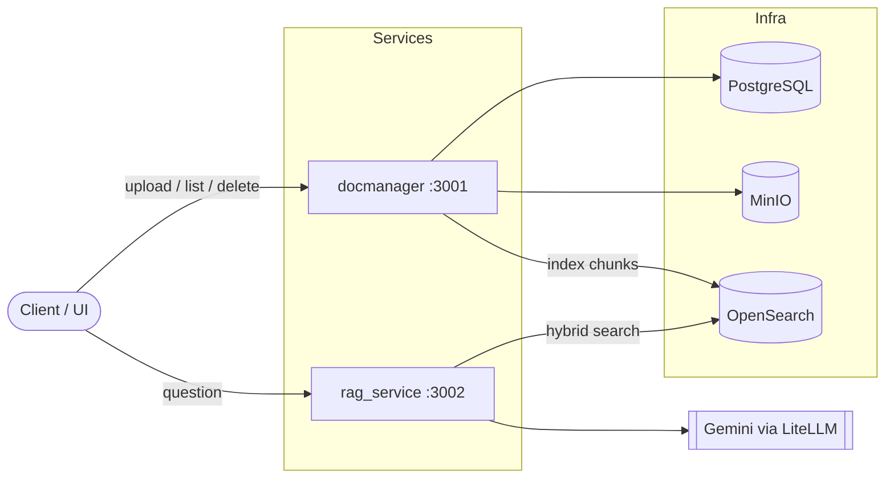
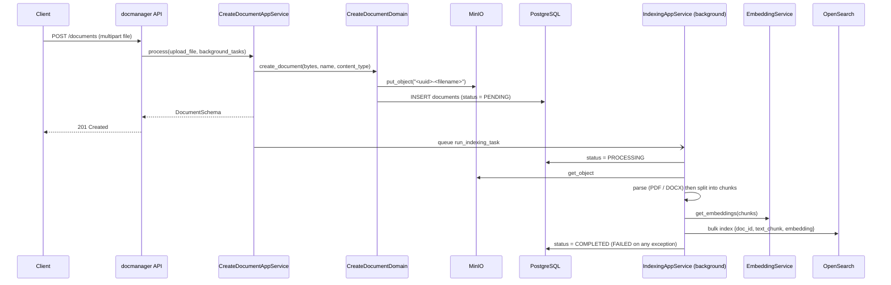
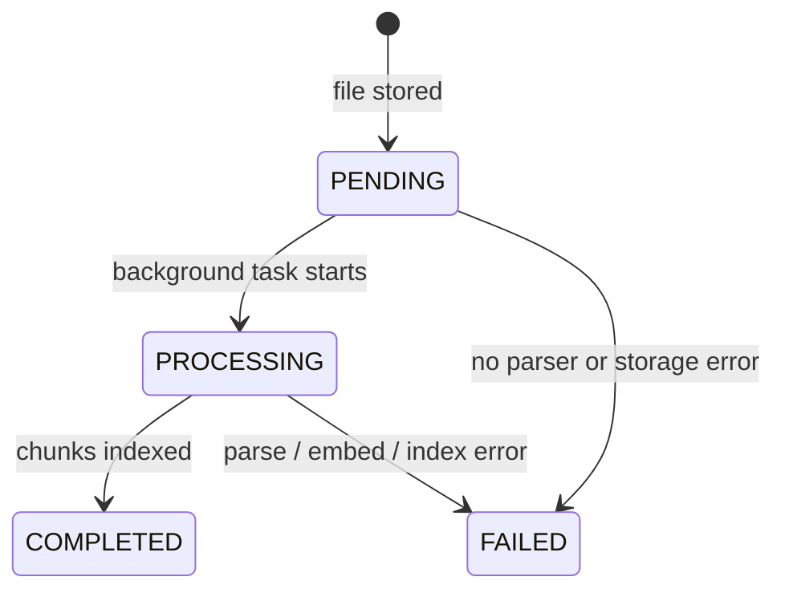
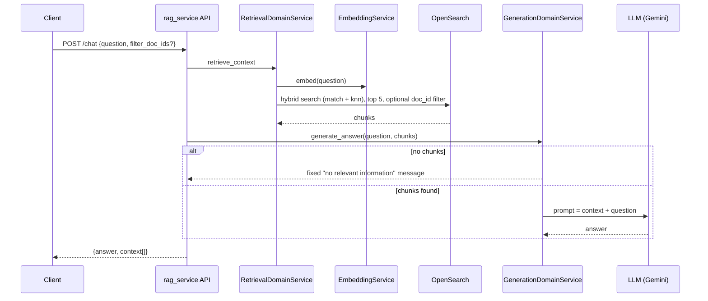

# RAG Service

A Retrieval-Augmented Generation (RAG) backend built as a Python monorepo. Users upload PDF/DOCX files, the system parses, chunks, embeds and indexes them, then answers questions using only the retrieved document context.

- **Document Manager (`docmanager`, port 3001):** upload, list and delete documents; background indexing pipeline.
- **RAG Service (`rag_service`, port 3002):** hybrid retrieval (BM25 + vector) and LLM answer generation.
- **Shared libs (`libs/*`):** thin, reusable adapters for Postgres, MinIO, OpenSearch, parsers, LLM/embeddings and logging.

## Table of contents

1. [Tech stack](#tech-stack)
2. [Architecture](#architecture)
3. [Monorepo layout](#monorepo-layout)
4. [Clean architecture per service](#clean-architecture-per-service)
5. [Workflows](#workflows)
6. [Data stores](#data-stores)
7. [API reference](#api-reference)
8. [Configuration](#configuration)
9. [Getting started](#getting-started)
10. [Development](#development)

## Tech stack

| Area | Technology |
|------|------------|
| Language | Python 3.10+ (containers use 3.12) |
| Web framework | FastAPI, Uvicorn |
| Monorepo / packaging | [uv](https://docs.astral.sh/uv/) workspaces, `uv_build` backend |
| Metadata DB | PostgreSQL 14, SQLAlchemy 2, Alembic, psycopg 3 |
| Object storage | MinIO (S3-compatible), `minio` SDK |
| Search / vector DB | OpenSearch 2.11 (k-NN plugin, HNSW, hybrid query, search pipeline), OpenSearch Dashboards |
| Embeddings | `sentence-transformers`, model `Alibaba-NLP/gte-multilingual-base` (768 dims) |
| LLM gateway | LiteLLM, Google Gemini (`gemini/gemini-2.0-flash`) |
| Parsing | PyMuPDF (PDF), python-docx (DOCX) |
| Chunking | LangChain `RecursiveCharacterTextSplitter` (1000 chars, 100 overlap) |
| Config | pydantic-settings (env, `.env`, YAML) |
| Quality | Ruff, mypy, pre-commit, pytest |
| Runtime | Docker, Docker Compose |

## Architecture



The two services never call each other. They share only the OpenSearch index (`rag_documents`) and the embedding model name, so both MUST use the same model and `embedding_dim`.

## Monorepo layout

The repo is a single [uv workspace](https://docs.astral.sh/uv/concepts/projects/workspaces/) (`pyproject.toml` at the root). Every directory under `libs/` and the two services are independent Python packages with their own `pyproject.toml`; they depend on each other through `{ workspace = true }` sources and share one `uv.lock`.

```
.
├── pyproject.toml            # uv workspace root, ruff / mypy / pytest config
├── uv.lock                   # single lockfile for all packages
├── docker-compose.yml        # infra + both services
├── .env.examples             # secrets template (copy to .env)
├── .pre-commit-config.yaml
├── libs/                     # shared adapters (no business logic)
│   ├── postgres/             # SQLAlchemy models, repository, controller, Alembic migrations
│   ├── storage/              # MinIO client (upload / get / delete)
│   ├── open_search/          # OpenSearch client, index + search pipeline bootstrap, hybrid search
│   ├── parser/               # Strategy pattern: PdfParser, DocxParser
│   ├── llm/                  # EmbeddingService (sentence-transformers), LLMService (LiteLLM)
│   └── logger/               # shared logging setup
└── services/
    ├── docmanager/           # document lifecycle + indexing
    │   └── src/docmanager/
    └── rag_service/          # question answering
        └── src/rag_service/
```

Why a monorepo: one lockfile and one toolchain, atomic changes across a lib and its consumers, and services stay small because infrastructure code lives in `libs/`.

| Package | Depends on (workspace) |
|---------|------------------------|
| `docmanager` | postgres, storage, open_search, parser, llm, logger |
| `rag_service` | open_search, llm, logger |

## Clean architecture per service

Both services use the same four layers. Dependencies point inward only: `api -> application -> domain`, and infrastructure is reached through the `libs/` adapters.

```
services/<service>/src/<service>/
├── api/
│   ├── routers/        # HTTP endpoints, request validation, error to HTTP mapping
│   └── schemas/        # Pydantic request / response models
├── application/        # use-case orchestration, one package per use case
│   └── <useCase>/service.py
├── domain/             # core business rules, one package per use case
│   └── <useCase>/service.py
├── shared/
│   ├── settings.py     # pydantic-settings (env > .env > settings.yaml)
│   └── exceptions.py
├── settings.yaml       # non-secret defaults
├── Dockerfile
└── __init__.py         # FastAPI app, lifespan (creates clients), `main()` entrypoint
```

| Layer | Responsibility | Example |
|-------|----------------|---------|
| API | Parse HTTP, call one application service in a threadpool, map exceptions to status codes | `document_router.py`, `rag_router.py` |
| Application | Orchestrate a use case, read clients from `app.state`, wire domain services, manage status transitions | `CreateDocumentAppService`, `IndexingAppService`, `RAGAppService` |
| Domain | Single-purpose business logic with injected dependencies | `IndexingDomainService` (embed + index), `RetrievalDomainService`, `GenerationDomainService` |
| Infrastructure | External systems, kept in `libs/` and constructed once in the FastAPI `lifespan` | `SQLDatabase`, `MinioService`, `OpenSearchService`, `EmbeddingService`, `LLMService` |

Patterns used:

- **Dependency injection through `app.state`:** clients are created once in `lifespan` and closed on shutdown.
- **Repository interface + controller:** `IDocumentRepository` / `IOpenSearchRepository` define the contract; `DocumentController` / `OpenSearchController` implement it.
- **Strategy:** `IParserStrategy` with `PdfParser` and `DocxParser`, selected by MIME type.
- **One application service per use case,** each exposing a single `process(...)` entrypoint.

## Workflows

### 1. Document upload and indexing

`POST /api/v1/documents` returns `201` immediately with status `PENDING`. Indexing runs afterwards as a FastAPI `BackgroundTask`.



Document status machine:



Supported content types: `application/pdf` and `application/vnd.openxmlformats-officedocument.wordprocessingml.document` (DOCX). Any other type ends in `FAILED`.

### 2. Question answering



The prompt instructs the model to answer only from the provided context (`domain/generation/prompts.py`).

### 3. Hybrid search

`OpenSearchController` creates, if missing, a search pipeline and an index at startup.

- **Query:** a `hybrid` query with two sub-queries: BM25 `match` on `text_chunk` and `knn` on `embedding` (`k=50` candidates). The final result size is 5.
- **Score fusion:** a `normalization-processor` applies `min_max` normalization and an `arithmetic_mean` combination with weights `[0.3, 0.7]` (text, vector).
- **Filtering:** when `filter_doc_ids` is given, the hybrid query is wrapped in a `bool` query with a `terms` filter on `doc_id`.
- **Index mapping:** `knn_vector` (HNSW, `nmslib`, `l2`, dimension 768), `doc_id: integer`, `text_chunk: text`.

### 4. Document deletion

`DELETE /api/v1/documents/{doc_id}` removes the OpenSearch chunks, the MinIO object and the Postgres row (`DeleteDocumentDomain`).

## Data stores

| Store | Holds | Notes |
|-------|-------|-------|
| PostgreSQL | `documents` table: `id`, `file_name`, `minio_path`, `status`, `created_at` | Schema managed by Alembic in `libs/postgres/src/postgres/migrations` |
| MinIO | Original files, bucket `documents`, object name `<uuid>-<original name>` | Bucket is auto-created on first upload |
| OpenSearch | Index `rag_documents`: one document per chunk (`doc_id`, `text_chunk`, `embedding`) | Chunk id is `<doc_id>_<chunk_index>` |

## API reference

Interactive docs: `http://localhost:3001/docs` and `http://localhost:3002/docs`. Both services expose `GET /health`.

### docmanager (`/api/v1`)

| Method | Path | Description |
|--------|------|-------------|
| `GET` | `/documents?status=&order_by=created_at:desc&limit=20` | List documents. `limit` is 1 to 1000. |
| `POST` | `/documents` | Upload one file (`multipart/form-data`, field `file`). Returns `201` with the new record. |
| `DELETE` | `/documents/{doc_id}` | Delete a document everywhere. Returns `204`. |

### rag_service (`/api/v1`)

| Method | Path | Body | Response |
|--------|------|------|----------|
| `POST` | `/chat` | `{"question": "...", "filter_doc_ids": [1, 2]}` (`filter_doc_ids` optional) | `{"answer": "...", "context": [{"doc_id": 1, "text_chunk": "..."}]}` |

Example:

```bash
curl -F "file=@report.pdf" http://localhost:3001/api/v1/documents
curl -X POST http://localhost:3002/api/v1/chat \
  -H "Content-Type: application/json" \
  -d '{"question": "What does the report conclude?"}'
```

## Configuration

Settings are loaded by pydantic-settings with this precedence (highest first): process environment, `.env`, `settings.yaml`. Nested keys use `__` (for example `POSTGRES__USER`).

Secrets go in `.env` (copy `.env.examples`, which is git-ignored once renamed):

| Variable | Used by | Purpose |
|----------|---------|---------|
| `POSTGRES__USER`, `POSTGRES__PASSWORD`, `POSTGRES__DB` | postgres, docmanager | Database credentials |
| `MINIO__ACCESS_KEY`, `MINIO__SECRET_KEY` | minio, docmanager | MinIO root credentials |
| `OPENSEARCH__HTTP_AUTH_USER`, `OPENSEARCH__HTTP_AUTH_PASS` | both services | Basic-auth values passed to the client |
| `GOOGLE_API_KEY` | rag_service | Mapped to `LLM__API_KEY` for LiteLLM / Gemini |

Non-secret defaults live in `services/<service>/src/<service>/settings.yaml`: server host/port, MinIO endpoint and bucket, OpenSearch host/index, embedding model, LLM `temperature` (0.1) and `top_p` (0.9).

## Getting started

Prerequisites: Docker with Compose v2. For local (non-Docker) work also install [uv](https://docs.astral.sh/uv/).

```bash
# 1. Create the env file and fill in the values
cp .env.examples .env

# 2. Start everything (Postgres, MinIO, OpenSearch, Dashboards, both services)
docker compose up --build
```

| Endpoint | URL |
|----------|-----|
| Document Manager | http://localhost:3001 |
| RAG Service | http://localhost:3002 |
| MinIO console | http://localhost:9001 |
| OpenSearch | http://localhost:9200 |
| OpenSearch Dashboards | http://localhost:5601 |
| PostgreSQL | localhost:5432 |

Notes:

- The first start downloads the embedding model into `./.cache/huggingface` (mounted into both containers).
- OpenSearch runs single-node with the security plugin disabled, with a 512 MB heap. This is for development only.
- Apply the database schema with Alembic before first use; the services do not create tables themselves. `env.py` reads `POSTGRES__USER`, `POSTGRES__PASSWORD`, `POSTGRES__DB` and `POSTGRES__HOST` (and optionally `POSTGRES__PORT`) from the environment:

  ```bash
  export POSTGRES__HOST=localhost   # plus the POSTGRES__* values from .env
  cd libs/postgres/src
  uv run --package postgres alembic upgrade head
  ```

## Development

```bash
uv sync                            # install the whole workspace into .venv
uv run pre-commit install          # ruff, ruff-format, mypy, pyupgrade, uv-lock, ...
uv run pytest                      # tests (pythonpath = ., services, libs)
uv run docmanager                  # run a service locally (needs infra reachable)
uv run rag_service
```

When running outside Docker, point the hosts in `settings.yaml` (`postgres_db`, `minio`, `opensearch_node`) at `localhost`.

Adding a new lib: create `libs/<name>` with its own `pyproject.toml`, add `<name> = { workspace = true }` under `[tool.uv.sources]` in the root and in each consuming service, then run `uv sync`.
